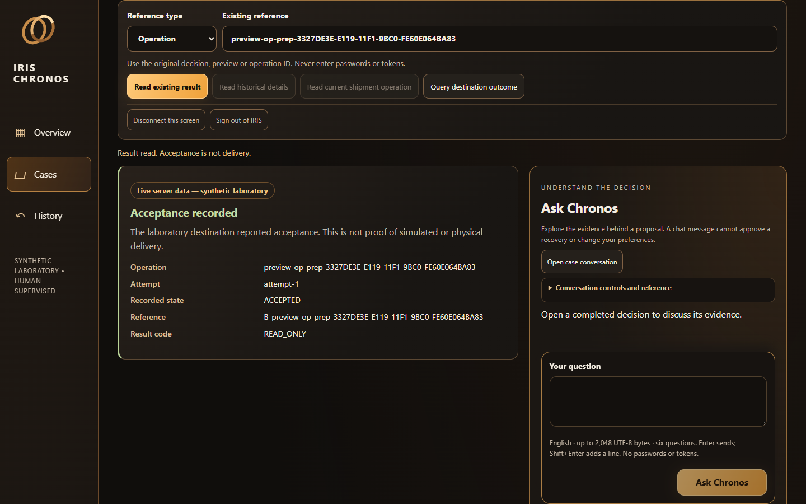

# IRIS Chronos

**A checked recovery, a human decision, a receipt you can reopen.**

IRIS Chronos is an AI Hub agent inside an InterSystems Interoperability production. It interprets a customer's shipment request, checks cost, arrival time, inventory validity and prior acceptance, and presents eligible recovery options. A human confirms one exact operation; Chronos preserves its receipt for later inspection.

The useful connection is the whole case: the customer's intent, checked alternatives, native human clarification, explicit approval and original receipt remain linked. An explanation never becomes permission to send.

## See it and run it

| Route | What to expect |
| --- | --- |
| [62-second overview](https://seypherwork.github.io/iris-chronos/) | Historical recording of the earlier interface and recovery walkthrough; not a new execution or a demonstration of every 1.1 feature. |
| [Recorded rehearsal](deployment/RECORDED-REHEARSAL.md) | Four fixed cases and four exact questions. Captured interpretations, current IRIS checks and local authentication. No fresh inference, model weights, GPU or external service credentials. |
| [Live agent](deployment/JURY-ROUTE.md#short-acceptance-checklist) | New wording, native Workflow clarification and grounded case chat using the [pinned model](deployment/MODEL-RECIPE.md). |

Both local routes require an authorized **IRIS AI Hub Community 2026.3.0AI.154.0** image, Docker Compose and Python. Obtain the image through [authorized InterSystems access](https://evaluation.intersystems.com/Eval/early-access/AIHub); images, weights and credentials are not included.

## Follow the decision

Start the live `ambiguous` case. Chronos holds the decision until an Operator answers a native Workflow task. That clarification supplies information; it does not approve a shipment. A new evaluation can then recommend B for earlier arrival.

Inspect the separate fresh preview, including target and cost of 6 within budget 8, and confirm explicitly. Reopen the same operation to inspect its receipt.

The case chat uses familiar message bubbles, a multiline composer and a visible pending state during the real request. Ask why B was proposed instead of A, whether chat changed anything, or to send again. Answers follow checked case evidence. Chat cannot change preferences, confirm, dispatch or resend. It displays validated answers rather than unverified streaming tokens.

## Installation and evidence

Version 1.1.1 corrects the complete-application installer to accept the hash-verified IPM descriptor included in the archive. The native module evidence below was obtained with 1.1.0; no new native feature is implied by this installer correction.


The [IPM module](module.xml) installs native ObjectScript classes and the production definition. The complete application additionally needs the documented Compose services, Python components, web assets, private storage and access setup. IPM 0.10.10 installed version 1.1.0 and compiled all 52 expected source classes on AI Hub 154. This is separate from complete application acceptance. Native Workflow, recorded rehearsal and live UI chat have individual evidence; one local instrumented portable interruption challenge now has matching native recovery and UI receipt evidence. The final startup and wording corrections were checked separately; see the [scope and limits](deployment/EVIDENCE.md#version-111-corrections-and-new-recovery-observation).

See [evidence and limits](deployment/EVIDENCE.md), [case contracts](deployment/JURY-CASE.md) and [access controls](deployment/WEB-ACCESS.md). All shipment data is synthetic. Acceptance is a software acknowledgement; simulated delivery does not prove physical delivery.

[MIT licence](LICENSE)

To load the native module from a reviewed checkout, use an interoperability-enabled namespace with IPM enabled:

```objectscript
zpm "load /ABSOLUTE/PATH/TO/iris-chronos -nodev"
```

This loads classes; follow the chosen Compose guide for the complete application.

<details>
<summary>Current native interface: original receipt after recovery</summary>



Actual synthetic laboratory capture; the portable observer qualification is retained in the evidence index.
</details>
